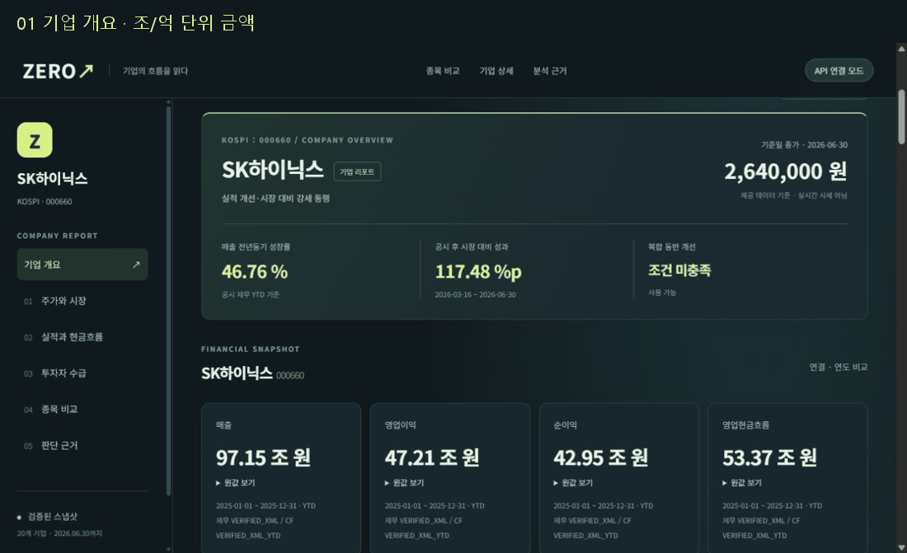

# TEAM ZERO

기업 실적·현금흐름·투자자 수급·주가의 **동행과 괴리를 근거와 함께 탐색하는 웹 대시보드**입니다. 기존 Silver와 표준 사전을 재사용해 목적별 Gold를 계산하고, 읽기 전용 API와 화면·CSV로 제공합니다.

보유 **20종목**, 주가 **2022-12-01~2026-06-30**의 고정 데이터입니다. 실시간 시세·인과 분석·매매 추천을 제공하지 않습니다.

[](docs/dashboard-gallery.md)

[화면 7장과 설명](docs/dashboard-gallery.md) · [신규 Gold 최종 수용 기록](docs/handoffs/Gold-final-acceptance.md) · [이전 README 원문](docs/archive/README_이전.md)

## 현재 구현과 확인 범위

2026-10-15 로컬 확인 기준: `feature/c-gold-final-acceptance`, 문서 작성 전 HEAD `5372c4dade48036e8e3265af66472058417d3cf2`.

- C 신규 Gold 2개 계산, B의 Delta 저장·MySQL 전량 대사, CSV API와 A 화면 연결 구현이 있습니다.
- [Gold 수용 기록](docs/handoffs/Gold-final-acceptance.md)은 신규 Gold 17,760행의 저장·SQL 검사와 실제 CSV API/브라우저 검증을 기록합니다. 신규 C MySQL 테이블을 API가 직접 조회하는 동작은 그 검증 범위에 포함되지 않습니다.
- [S5 통합 기록](docs/handoffs/S5-integration.md)과 [UI 병합 기록](docs/handoffs/A-visual-merge.md)은 integration 병합을 기록합니다. **main 승격·전체 Bronze 재현·운영 배포 완료를 뜻하지 않습니다.** 이번 문서 작업에서는 원격 상태를 조회하지 않았습니다.
- 계획서·하위 README에 남은 초기 대기 문구는 이력입니다. 현재 수용 범위는 위 최신 handoff와 증거를 함께 확인합니다.

## 실제 저장소 구조와 데이터 흐름

| 경로 | 역할 |
|---|---|
| `apps/web/` | Vite 기반 화면, 차트·필터·근거·CSV, 단위/Playwright 검사 |
| `backend/service/` | FastAPI, CSV·Delta·MySQL 읽기 어댑터, C 산출물 패키징·저장 도구 |
| `backend/medallion_pipeline/` | B의 원본·Silver·Gold 저장/검증 파이프라인 |
| `analysis/` | Pandas Gold 계산·품질 규칙·API/SQL 독립 대조·증빙 |
| `contracts/`, `fixtures/` | API·분석·시각화·환경 계약과 합성 응답 |
| `data/03_C_integration_20261014/` | 수정 금지 고정 인계본 75파일 |
| `docs/handoffs/`, `.github/workflows/` | 단계별 수용 기록과 자동 검사 정의 |
| `build/` | 로컬 생성 결과·실행 증빙. clone에 포함된다고 가정하지 않음 |

```text
추가 확보 원본 → B Bronze → Silver → Gold Delta → MySQL 복제/대사
                            ↑
고정 Silver 17 CSV → C Gold 계산 → B 패키징 → CSV API → A 화면/CSV
                          └────→ B 신규 Gold Delta → MySQL → C SQL 대사
```

전체 원본 경로의 재현에는 별도 입력과 환경이 필요합니다. 화면 수용 검증은 위 CSV API 경로를 사용했습니다. Delta는 실제 `_delta_log`와 Parquet를 가진 저장 형식이며 MySQL 스키마 이름과 구분합니다. [환경 계약](contracts/runtime.md) · [분석 계약](contracts/analysis.md) · [API 계약](contracts/api.md)

## 로컬 실행

저장소 루트에서 실행합니다. Python 의존성과 Node 의존성이 준비되어 있어야 합니다. 아래 환경 구성은 사용자가 새 환경을 만들 때의 절차이며, 이번 README 작업에서는 설치하지 않았습니다.

- B 환경: Python 3.12, `backend/service/requirements.lock.txt` 기준.
- C 환경: Python 3.13, `analysis/requirements.txt` 기준.
- 화면: Node 22.12 이상, `apps/web/package-lock.json` 기준.
- Windows 초기 설정은 [서비스 안내](backend/service/README.md)의 `setup.ps1`을 따릅니다. 아래는 macOS/Linux 셸 문법입니다. CI도 같은 모듈과 실행기를 사용합니다.

```bash
# 최초 환경 구성 시에만 실행
python3.12 -m venv build/b-venv
build/b-venv/bin/python -m pip install -r backend/service/requirements.lock.txt
python3.13 -m venv build/c-venv
build/c-venv/bin/python -m pip install -r analysis/requirements.txt
npm --prefix apps/web ci
```

먼저 원본 무결성을 확인하고, C 계산 결과를 B API용 묶음으로 만듭니다. 패키징 출력은 기존 경로가 있으면 거부하므로 새 이름을 사용합니다.

```bash
python3 scripts/check_handoff.py
build/c-venv/bin/python -m analysis.run --output build/analysis
build/b-venv/bin/python backend/service/pack_c_analysis.py --source build/analysis --output build/c-artifact --project-root .
```

API 터미널:

```bash
build/b-venv/bin/python backend/service/run.py --backend csv --project-root . --analysis-dir build/c-artifact --port 8000
```

화면 터미널:

```bash
VITE_DATA_MODE=api VITE_API_BASE_URL=http://127.0.0.1:8000 npm --prefix apps/web run dev -- --port 5173 --strictPort
```

화면 주소 `http://127.0.0.1:5173`, OpenAPI `http://127.0.0.1:8000/docs`. 종료는 각 실행 터미널에서 Ctrl+C입니다. 기본 화면 모드는 fixture이므로 실제 데이터 시연에는 위 API 설정이 필요합니다. `--analysis-dir` 없이 CSV API를 실행하면 C 신규 분석은 미연결 상태입니다. `.env`는 B 실행기가 자동 로드하지 않습니다.

검사 명령과 전체 통합 환경 변수는 [.github/workflows/integration.yml](.github/workflows/integration.yml)에 있습니다.

```bash
build/c-venv/bin/python -m unittest discover -s analysis/tests -q
build/b-venv/bin/python -m pytest backend/service/tests -q
npm --prefix apps/web test
npm --prefix apps/web run build
```

Delta/MySQL 검사는 새 run·격리 DB·접속 환경을 준비한 뒤 [Gold 수용 기록](docs/handoffs/Gold-final-acceptance.md)의 절차를 따릅니다. 전체 Bronze 복원에 필요한 입력은 [G04 기록](docs/handoffs/G04-validation.md)을 확인합니다.

## 데이터와 분석 규칙

| 데이터 | 범위·근거 |
|---|---|
| 고정 인계본 | 75파일, Silver 17개 총 371,437행, 기존 Gold 2개. [명세](data/handoff_manifest.json) |
| 기업·가격 | 20종목(KOSPI 14/KOSDAQ 6), 872거래일, 가격 17,440행 |
| 재무·수급 | 2022~2025년 320보고서, 투자자별 매매 191,829행 |
| 신규 Gold | `g_fin_rpt_analysis` 320행, `g_stock_daily_analysis` 17,440행, `c-gold-0.1.0` |

컬럼·키·단위는 [데이터 사전](docs/data-catalog.md), 신규 스키마와 계산 결과는 [analysis/evidence/schema.json](analysis/evidence/schema.json)·[validation.json](analysis/evidence/validation.json)을 따릅니다.

- **공시일 < 거래일**만 연결하며 공시 당일은 사용하지 않습니다.
- YTD·Q3M·ASOF, 연결·별도, 검증 기간·가정 기간을 구분합니다.
- 재무를 일별 행에서 반복 합산하거나 기관 합계와 세부를 이중 합산하지 않습니다.
- 금액 원·수급 주·비율 소수 비율을 계약하며, NULL·0·미연결·격리·REVIEW를 구분합니다.
- 동행/괴리는 매출 성장과 공시 후 시장 대비 성과의 관측 분류이며 현금·수급을 보조 근거로 확인합니다. [지표 정의](contracts/analysis.md) · [차트 계약](contracts/visualization.md)

## 검증 결과와 한계

**이번 문서 작업에서 직접 실행:** `python3 scripts/check_handoff.py` → 75파일 해시·크기와 CSV 33개 헤더/행수 PASS. DB·Delta·203개 과거 검사를 재실행한 결과가 아닙니다.

**기존 실행 증빙을 열어 확인한 결과**(이번 작업에서 서버·브라우저·DB를 재실행하지 않음):

| 검증 | 기록된 결과 | 증거 |
|---|---|---|
| 신규 Gold 저장·SQL | 17,760행 전체 대사, SQL 222/222 PASS, PIT 위반·성장률 불일치 0 | [gold-storage-validation.json](analysis/evidence/gold-storage-validation.json) |
| C 계산 / B API / 저장 안전성 | 49 PASS / 49 PASS·2 SKIP / 모의검사 6 PASS | [Gold 수용 기록](docs/handoffs/Gold-final-acceptance.md) |
| A 단위 / 빌드 / Chromium | 17 PASS / PASS / 18 PASS | [UI 기록](docs/handoffs/A-visual-merge.md) |
| CSV API 전량 대조 | 일별 17,440·재무 320·비교 20종목 및 수출 값 차이 0 | [수용 범위](docs/handoffs/Gold-final-acceptance.md), 로컬 `build/gold-final/api-check.json` |

숫자 표기 정규화로 CSV 바이트가 달라도 값은 같을 수 있습니다. 식별자·키·행·컬럼·값을 대조하며 파일 해시 동일과 구분합니다. 원래 인계본의 203 PASS는 신규 기능의 완료 증거로 사용하지 않습니다.

남은 사항:

- 기간 미검증 61보고서, PIT 재무 미연결 1,607행, 수급 격리 1키와 연속성 REVIEW를 보존합니다.
- 고정 75파일에는 Bronze 입력 18개·공시 원문 ZIP·덤프·실제 Delta가 없습니다. B의 외부 원본 기반 기존 58테이블/복원 증빙은 신규 Gold 수용과 별도 검토 대상입니다.
- 신규 C MySQL → API 직접 조회 검증, 전체 프로젝트 최종 수용·main 승격·운영 배포는 남아 있습니다. [잔여 범위](docs/handoffs/Gold-final-acceptance.md)

## 역할을 선택하고 바로 시작하기

| 역할 | 담당·경로 | 시작 지침 |
|---|---|---|
| A 이어진 | 화면 `apps/web/` | [A 프롬프트](prompts/A_frontend.md) |
| B 설호현 | 저장·API `backend/` | [B 프롬프트](prompts/B_backend.md) |
| C 김형준 | 지표·검증 `analysis/` | [C 프롬프트](prompts/C_analysis.md) |

작업 전 [AGENTS.md](AGENTS.md)·[START_HERE.md](START_HERE.md)·해당 프롬프트를 읽고 기존 구현을 확인합니다. [체크북](docs/workbook.md)의 A01~C12/G01~G05/F01~F08, [보완 업무 M01~M14](docs/missing-work.md), [통합 진행표](docs/integration-status.md), [브랜치·인수인계 절차](docs/integration-workflow.md)를 함께 확인합니다. 이 README는 문서 정비이며 체크북의 미확인 항목을 자동 완료 처리하지 않습니다.
