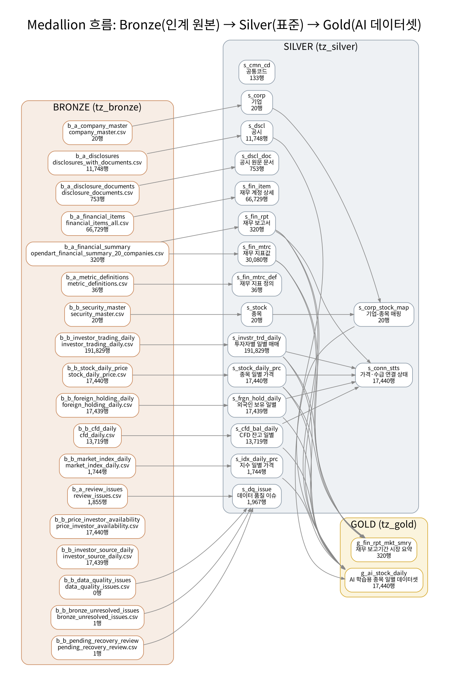
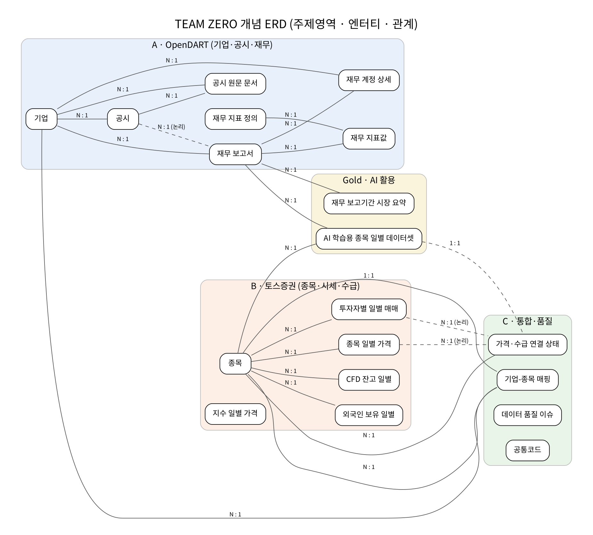
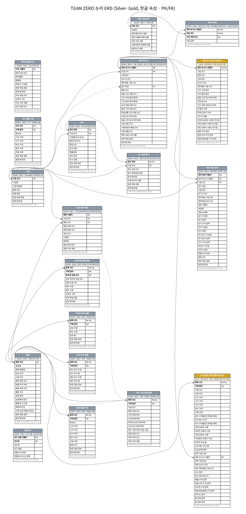
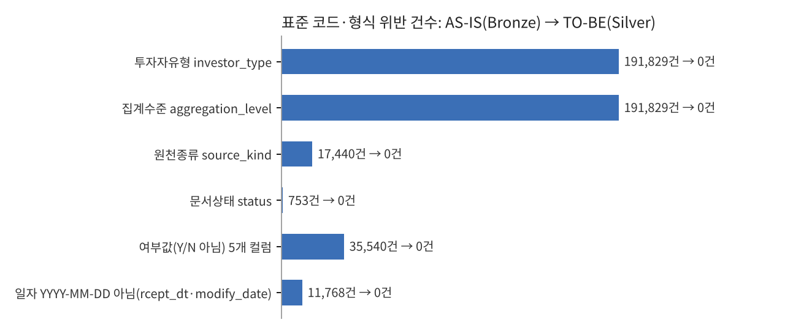

# 0. 한 장 요약

A(OpenDART)와 B(토스증권)에게서 받은 실버 후보 데이터를 C가 하나의 표준으로 묶었습니다. 이 과정은 네 단계로 진행했습니다. 먼저 받은 데이터의 현재(AS-IS) 품질을 수치로 진단했습니다. 진단 결과로 AI 데이터 표준 사전을 만들었고, 사전을 그대로 적용해 Bronze → Silver → Gold 모델을 설계한 뒤 MySQL 8.0에 계층별 테이블로 적재했습니다. 마지막으로 적재 결과를 SQL과 Pandas로 이중 검증했습니다.

| 항목 | 결과 |
|---|---|
| 입력 | A 7개 파일, B 11개 파일, 총 356,676행(프로파일 대상 14개 테이블) |
| AS-IS 진단 | 결측·중복·형식·코드값·명명 5개 축 23개 지표. 키 중복 0건이지만 형식·코드 표기 혼용이 넓게 퍼져 있음 |
| 표준 사전 | 표준 단어 168개(분류어 18개), 도메인 26개, 코드그룹 30개·코드값 133개, 표준 용어(컬럼) 345개 |
| TO-BE 모델 | Bronze 18개, Silver 17개, Gold 2개, Meta 4개 테이블. PK·FK·CHECK 제약을 걸어 MySQL에 구현 |
| 명명 표준 준수율 | AS-IS **2.92%** → TO-BE **100%** (MySQL information_schema 기준) |
| 도메인·코드 규칙 위반 | AS-IS 449,159건 → TO-BE **0건** |
| 검증 | 203개 항목 **전부 PASS**: 레이어 건수 대사, 키 무결성, 출처 추적, 재실행 일관성, A 스크립트 교차검증 |
| C 통합 산출물 | 기업-종목 매핑 20/20 MATCHED, 가격·수급 연결 17,439 BOTH + 1 PRICE_ONLY, 품질 이슈 1,967건 통합 |
| AI 데이터셋 | `g_ai_stock_daily` 17,440행 × 34열. 공시일 < 거래일 조건으로 재무를 붙였고 시점 누수 0건 |

> 이 보고서의 수치는 모두 패키지 안의 CSV(`01_profiling`, `05_validation`)에서 나왔습니다. 같은 입력으로 다시 실행하면 결과 파일 19개의 SHA-256이 그대로 재현됩니다.

# 1. 배경과 범위

## 1.1 세 명의 역할 (실버 진행 계획 기준)

| 담당 | 책임 영역 | 이번에 받은 결과 |
|---|---|---|
| A | OpenDART: 기업·공시·재무·원문 | `02_C_handoff_20261014`: 재무 요약 320행(20개 기업, 2022~2025, 36개 지표), 계정 상세 66,729행, 공시 11,748행, 원문 753행 |
| B | 토스증권: 종목·가격·지수·수급·외국인 보유 | `Team_B_Silver_Handoff` v1.1.0: 일봉 17,440행, 지수 1,744행, 수급 191,829행, 외국인 보유 17,439행, CFD 13,719행 |
| C | 통합·공통 품질 | 이 패키지: 공통 규격(표준 사전), 기업-종목 매핑, 연결 상태, 실행·추적, 통합 검증, MySQL 레이어 구현 |

## 1.2 C가 지킨 공통 규칙

- A·B 인계본은 읽기 전용으로만 썼습니다. 결과는 별도 폴더(`04_output`)와 별도 DB에 저장했습니다.
- 식별자(`corp_cd`·`stock_cd`·`rcept_no`)는 문자열로 다뤄 선행 0을 보존했습니다.
- 금액은 정수 문자열 그대로 `DECIMAL(20,0)`에 넣었습니다. float 변환은 하지 않았습니다.
- 빈값은 NULL로 두고 0으로 채우지 않았습니다.
- 가격과 수급은 내부조인하지 않았습니다. 키 합집합으로 연결 상태를 남겨 어느 한쪽 행도 사라지지 않게 했습니다.
- B가 격리한 1행(247540 / 2026-04-16 수급)은 자동으로 합치지 않았습니다. 검토 대기 상태로 기록만 했습니다.
- A가 정한 시점 조인 규칙(공시일 < 거래일, 최신 기간, CFS 우선, 최신 접수번호)은 그대로 구현했습니다. A의 `join_daily_for_c.py` 결과와 17,440행 전부 일치합니다.

# 2. AS-IS 프로파일링 (Pandas)

`code/profile_asis.py`가 14개 테이블, 337개 컬럼, 7,237,130개 셀을 컬럼 단위로 프로파일링했습니다. 컬럼마다 결측 수, 자리표시값, 고유값 수, 최대 길이, 값 패턴 분포, 명명 스타일, 표준 준수 여부를 측정했습니다(`01_profiling/asis_column_profile.csv`). 서로 다른 형식의 값이 섞인 컬럼이 51개였습니다.

| 축 | 진단 항목 | 건수 / 기준 | 비율 |
|---|---|---:|---:|
| 결측 | 재무 상세 당기금액(`thstrm_amount`) 빈값 | 2,202 / 66,729 | 3.3% |
| 결측 | 재무 요약 공시일 빈값(공시목록 수집 범위 밖) | 61 / 320 | 19.1% |
| 결측 | CFD 잔고 미제공 종목·거래일(2023-08-31 이전) | 3,721 / 17,440 | 21.3% |
| 결측 | 수급 없음(가격만 있는 키) | 1 / 17,440 | 0.006% |
| 중복 | 선언된 키 기준 중복 | 0 / 356,676 | 0% |
| 중복 | 재무 상세 '접수번호+연결구분+양식+계정ID+상세' 키 충돌 | 9,120 / 66,729 | 13.7% |
| 형식 | 날짜 YYYYMMDD 문자열(`rcept_dt`·`modify_date`) | 12,521 | 100% |
| 형식 | 시각 문자열에 `+09:00` 오프셋 포함 | 19,184 | 100% |
| 형식 | 출처 버전 표기 2종(A 패키지명 / B `sha256:`) | 67,049 | 100% |
| 코드값 | 불리언 표기 혼용(`True` 20, `true` 34,879, `false` 1, `1` 518, `0` 122) | 35,540 | 100% |
| 코드값 | 문서 상태 대소문자 혼용(`downloaded`·`unavailable` / `NOT_IN_INPUT`) | 11,748 | 100% |
| 코드값 | 투자자 유형 camelCase(`financialInvestment` 등) | 87,195 / 191,829 | 45.5% |
| 코드값 | 계정ID 자리표시값 `-표준계정코드 미사용-` | 11,639 / 66,729 | 17.4% |
| 코드값 | 계정상세 자리표시값 `-` | 40,835 / 66,729 | 61.2% |
| 명명 | camelCase 11개, `_` 접두사 12개 컬럼 | 23 / 337 | 6.8% |
| 명명 | 같은 개념, 다른 컬럼명(`stock_code`↔`symbol`, `_source_file`↔`source_file` 등) | 8쌍 | |
| 명명 | 표준 단어 조합 규칙 준수 컬럼 | 11 / 337 | 3.3% |
| 참조 | 재무 요약 접수번호 중 공시목록에 없는 건 | 61 / 320 | 19.1% |
| 참조 | 기업명 ≠ 종목명(같은 종목코드: 현대자동차 / 현대차) | 1 / 20 | 5% |

**해석.** A와 B 모두 자체 검증을 마친 상태여서 키 중복과 참조 오류는 거의 없었습니다. 통합에서 문제가 된 것은 두 팀이 같은 개념을 서로 다르게 표기한 부분입니다. 날짜(YYYYMMDD / ISO), 불리언(True / true / 1), 코드 대소문자, 컬럼명(snake / camel / `_` 접두사), 출처 버전 형식이 모두 달랐습니다. 이 차이를 그대로 두고 조인하면 키가 맞지 않거나 값이 잘못 해석됩니다. 표준 사전은 이 문제를 해결하려고 만들었습니다.

재무 상세의 9,120건 키 충돌은 실버 계획서 PDF가 경고한 숫자와 정확히 같습니다. `account_nm`·`ord`까지 포함하면 행이 구분되므로 중복이 아닙니다. 그래서 행은 삭제하지 않고 `fin_item_id`로 식별했습니다.

# 3. AI 데이터 표준 사전

## 3.1 구성

| 구성 | 개수 | 파일 |
|---|---:|---|
| 표준 단어 | 168 (분류어 18 + 일반어 150) | `std_word.csv` |
| 표준 도메인 | 26 | `std_domain.csv` |
| 표준 코드 | 30개 그룹, 133개 값(AS-IS 값 대응 포함) | `std_code.csv` |
| 표준 용어(컬럼) | 345 (23개 테이블) | `std_term.csv` |
| 조합 규칙 | 12개 | `std_naming_rule.csv` |
| AS-IS → TO-BE 컬럼 대응 | Silver 전체 | `asis_tobe_column_map.csv` |

모든 구성은 `AI_데이터_표준사전.xlsx` 하나의 엑셀 파일에도 시트별로 들어 있습니다. 사전의 원본 정의는 `code/std_dictionary.py` 한 곳에만 있습니다. DDL, ERD, 준수율 검사가 모두 이 파일에서 생성되므로 사전과 실제 DB가 어긋나지 않습니다.

## 3.2 단어 조합 규칙(요약)

- 물리명은 `[수식어_]*[주제어_]+분류어` 형식의 소문자 snake_case입니다. 모든 토큰은 표준 단어여야 하고, 길이는 40자 이하입니다.
- 마지막 토큰은 분류어이고, 분류어가 도메인을 정합니다. 예를 들어 `_dt`는 DATE, `_yn`은 CHAR(1) Y/N, `_amt`는 DECIMAL(20,0), `_cd`는 공통코드입니다.
- 동음이의와 이음동의를 모두 금지합니다. `symbol`과 `stock_code`는 `stock_cd`로 통일했고, `stock_cd`는 어느 테이블에서나 CHAR(6) 종목코드를 뜻합니다.
- 테이블 접두사가 계층을 나타냅니다: `b_` Bronze, `s_` Silver, `g_` Gold, `m_` Meta.

| AS-IS | TO-BE | 조합 |
|---|---|---|
| `symbol` / `stock_code` | `stock_cd` | 종목 + 코드 |
| `trade_date` | `trd_dt` | 거래 + 일자 |
| `net_buy_volume` | `net_buy_qty` | 순 + 매수 + 수량 |
| `holding_rate` | `hold_rt` | 보유 + 율 |
| `isCommonShare` (`True`) | `cmn_shr_yn` (`Y`) | 보통 + 주식 + 여부 |
| `rcept_dt` (`20230116`) | `rcept_dt` (`2023-01-16`, DATE) | 접수 + 일자 |
| `investor_type` (`financialInvestment`) | `invstr_type_cd` (`FIN_INVEST`) | 투자자 + 유형 + 코드 |
| `_source_file` / `source_file` | `src_file_path` | 원천 + 파일 + 경로 |

## 3.3 도메인과 코드(발췌)

| 도메인 | 타입 | 규칙 |
|---|---|---|
| STOCK_CD | CHAR(6) | `^[0-9]{6}$`, 선행 0 보존 |
| CORP_CD | CHAR(8) | `^[0-9]{8}$` |
| RCEPT_NO | CHAR(14) | `^[0-9]{14}$` |
| AMT_KRW | DECIMAL(20,0) | 원 단위 정수, 음수 허용, 빈값은 NULL(0 대체 금지) |
| PRICE | DECIMAL(18,4) | 0 이상 |
| QTY | BIGINT | 순매수는 음수 허용 |
| RATE | DECIMAL(12,8) | 소수 비율(1 = 100%) |
| YN | CHAR(1) | Y/N만 허용 |
| DATE / DATETIME | DATE / DATETIME | 한국시간(KST). 오프셋 문자열은 변환해서 적재 |
| CODE_V50 | VARCHAR(50) | 공통코드 허용값만 |

코드 표준은 모두 대문자 snake 형식입니다. AS-IS 값은 `asis_val_txt`에 대응해 두었습니다. 예: `individual→INDIVIDUAL`, `financialInvestment→FIN_INVEST`, `downloaded→DOWNLOADED`, `true/True/1→Y`. 재무 지표 36개도 `MTRC` 코드그룹으로 관리합니다.

> 검토 중 발견한 점: 처음에 코드 도메인 길이를 30으로 잡았습니다. 그런데 재무 지표 코드 `CURRENT_PORTION_LONG_TERM_DEBT_REPORTED`가 39자여서 MySQL strict mode에서 적재가 거부됐습니다. 도메인을 VARCHAR(50)으로 바꾸고, 파이프라인 자체 검사에 길이 확인도 추가했습니다.

# 4. TO-BE 모델: Delta Lake Medallion을 MySQL로 구현

## 4.1 계층 구조

{height=20cm}

| 계층 | DB | 역할 | 테이블 |
|---|---|---|---|
| Bronze | `tz_bronze` | 인계 원본을 그대로 적재(전 컬럼 TEXT, AS-IS 컬럼명, 빈값 유지) + 적재 메타(`ldng_row_no`·파일·SHA-256·실행ID) | 18 |
| Silver | `tz_silver` | 표준 사전 적용: 타입, 코드, 명명, 정규화, PK·FK·CHECK | 17 |
| Gold | `tz_gold` | AI 학습용 일별 데이터셋, 보고기간 시장 요약 | 2 |
| Meta | `tz_meta` | 표준 단어·도메인·용어, 실행 기록(누적) | 4 |

Delta Lake의 Bronze·Silver·Gold 개념을 MySQL 스키마 세 개로 옮겼습니다. Delta의 버전 관리 기능은 `src_ver`(원천 해시), `pipln_ver`(파이프라인 버전), `m_exec_log`(실행별 입력 버전과 건수)로 대신합니다.

## 4.2 정규화 판단

| 결정 | 이유 |
|---|---|
| 재무 요약의 넓은 표(지표 94열)를 세로 표 `s_fin_mtrc`(보고서·지표·기간유형)로 바꿈 | 반복 컬럼 그룹 제거(1NF). 지표를 추가할 때 스키마를 바꾸지 않아도 됨. 320 × 94 = 30,080행 대사 일치 |
| `report_label`·`report_quarter` 제거 | `rpt_cd`에 함수 종속(3NF). 공통코드 `RPT`의 코드명과 정렬순서로 대체 |
| 재무 보고서의 `report_nm`·`disclosure_date`·`document_*` 제거 | 공시(`s_dscl`)와 원문(`s_dscl_doc`)의 속성. A 요약의 공시일과 공시목록 접수일이 259건 모두 같음을 검증(V4-BZ16)한 뒤 제거 |
| 공시와 원문 문서 분리(`s_dscl` 1 : 0..1 `s_dscl_doc`) | 원문은 753건에만 존재. 나머지 10,995건이 NULL 문서 속성을 갖지 않도록 분리 |
| 재무 상세의 `corp_name`·`stock_code`·`sj_nm` 제거 | 각각 기업 마스터, 매핑, 코드명으로 조회 가능 |
| 수급 JSON 원본(`investor_source_daily`)은 Bronze에만 보존 | Silver에는 B가 구조화한 `s_invstr_trd_daily`(종목·거래일·투자자유형)를 사용 |

## 4.3 식별키와 관계

- **물리 FK(Silver 안)**: 공시·원문·재무 → 기업, 재무 지표·상세 → 재무 보고서, 일별 가격·수급·보유·CFD·연결상태·매핑 → 종목.
- **논리 FK**: `s_fin_rpt.rcept_no → s_dscl`. 61건이 공시목록 수집 범위 밖이라 물리 FK를 걸지 않았고, 검증 항목으로 관리합니다. Gold → Silver 관계도 논리 FK입니다. Silver를 다시 적재해도 Gold가 막히지 않게 하려는 것입니다.
- **CHECK 제약(MySQL 8.0.16+)**: 코드 컬럼 허용값(IN), 식별자 정규식(REGEXP_LIKE), 가격 0 이상, OHLC 범위, 매수 − 매도 = 순매수, 외국인 보유율 0~1. 표준을 어기는 값은 DB가 적재 단계에서 거부합니다.

## 4.4 ERD

개념 ERD(주제영역·엔터티·관계)입니다.

{width=100%}

논리 ERD(한글 속성, PK/FK)와 물리 ERD(표준 물리명, MySQL 타입)는 크기가 커서 `03_model/erd/`의 SVG로 확대해 보는 편이 좋습니다. 아래는 축소본입니다.

{height=21cm}

# 5. 변환·적재·검증

## 5.1 실행 순서

```
python code/profile_asis.py        # AS-IS 진단
python code/run_pipeline.py        # 표준 적용 → Silver/Gold CSV, 품질 이슈, 실행 기록
python code/build_model.py         # 표준 사전 파일, DDL, ERD
python code/load_mysql.py  --user root --password ****    # MySQL 4개 DB 적재
python code/validate.py    --user root --password **** --rerun   # 검증 + 재실행 일관성
```

`run_pipeline.py`는 변환에 실패하거나 도메인·코드·PK 규칙을 어긴 값이 하나라도 있으면 `s_dq_issue`에 사유를 남기고 실패로 끝납니다(fail-fast). 첫 실행에서 실제로 이 검사에 걸린 값이 있었습니다. Decimal 수익률 0이 `0E-8`로 표기된 589건으로, 형식을 고친 뒤 통과했습니다.

## 5.2 검증 결과 (203개 항목 전부 PASS)

| 범주 | 항목 수 | 핵심 내용 |
|---|---:|---|
| V1 건수 대사 | 19 | Bronze → Silver 12개 테이블 행 보존. 재무 320 × 94 = 30,080. 가격∪수급 키 17,440. Silver → Gold 손실·팽창 0 |
| V1 값 대사 | 5 | 순매수 합 72,880,007, 종가 합, 재무 당기금액 합 257,769,303,776,618,175원, 빈값 2,202건이 Bronze와 Silver에서 정확히 일치(반올림·0 대체 없음) |
| V2 키 무결성 | 41 | PK 중복 0(19개 테이블). FK 고아 0. 논리 FK 미일치 61건은 A가 표시한 61건과 일치. 매핑 20/20 |
| V2 출처 추적 | 6 | Silver 행이 Bronze 원본 행(파일·행번호)으로 100% 역추적됨 |
| V3 표준 준수율 | 6 | AS-IS 2.92%(377개 컬럼) → TO-BE 100%(345개 컬럼: 명명·사전 등록·타입·NULL 모두 일치) |
| V4 코드 규칙 | 69 | 모든 코드 컬럼 값이 공통코드 안에 있음(위반 0) |
| V4 도메인 규칙 | 30 | 종목코드·기업코드·접수번호·연도·ISIN·해시 형식 위반 0 |
| V4 업무 규칙 | 16 | OHLC, 매수 − 매도 = 순매수, 기관 합계 = 세부 7유형 합, 보유율 범위, **시점 누수 0**, Gold 재계산 일치 |
| V4 AS-IS → TO-BE | 6 | 아래 그림 |
| V5 재실행 일관성 | 3 | 재실행 시 결과 19개 파일 해시 동일. MySQL 재적재 후 건수 변화 0. 실행 기록 누적 보존 |
| V6 교차검증 | 2 | Gold의 시점 재무 선택이 A 스크립트 결과와 17,440행 일치 |

{width=100%}

SQL 결과와 Pandas 결과를 같은 행에 나란히 기록했습니다(`validation_results.csv`의 `sql_result`·`pandas_result`). 두 값이 다르면 FAIL로 처리합니다. 실행한 SQL은 모두 `validation_queries.sql`에 남겨 MySQL Workbench에서 그대로 다시 돌려볼 수 있습니다.

> 검증 중 발견한 점: 실행 기록 테이블 `m_exec_log`는 누적 보존을 위해 매번 새로 만들지 않습니다. 그래서 도메인을 바꾼 뒤에도 옛 컬럼 정의(VARCHAR(30))가 남아 있었고, V3 타입 대조가 이 차이를 잡았습니다. 지금은 적재할 때마다 `ALTER … MODIFY`로 정의를 맞춥니다.

# 6. C 통합 산출물

## 6.1 기업-종목 매핑 `s_corp_stock_map`

종목코드 완전일치를 기준으로 매핑했고, 기업명은 검증 근거로만 썼습니다. 20건 모두 MATCHED이고 미연결·다중후보는 0건입니다. 명칭이 다른 1건(00164742 현대자동차 / 005380 현대차)은 약칭 차이로 판단했습니다. 종목코드 기준으로 확정하고 `NAME_MISMATCH / INFO / EXPLAINED`로 기록했습니다. 미연결이나 다중후보가 생기면 행을 지우지 않고 `map_stts_cd`로 남깁니다.

## 6.2 가격·수급 연결 상태 `s_conn_stts`

| 상태 | 키 수 | 처리 |
|---|---:|---|
| BOTH | 17,439 | 각 테이블 보존 |
| PRICE_ONLY | 1 | 247540 / 2026-04-16. B의 API 재조회값이 updatedAt 불일치로 검토 대기(`INVESTOR_PENDING_REVIEW`). 가격 행 유지 |
| INVESTOR_ONLY | 0 | |

계획서 작성 시점에는 가격만 있음 238건, 수급만 있음 438건이었습니다. B가 API 재조회 740행을 병합하면서 1건으로 줄었습니다. 연결 상태에는 외국인 보유·CFD 존재 여부와 재무 가용 여부(`fin_avail_yn`)도 함께 표시했습니다.

## 6.3 품질 이슈 통합 `s_dq_issue` (1,967건)

| 탐지 단계 | 건수 | 내용 |
|---|---:|---|
| A 자체 검증 | 1,855 | 보조 지표 매핑 불가 1,721(INFO), 원문 기간 미검증 61, 공시일 없음 61(시점 조인 제외), 원천 빈값 11, 계정 충돌 1 |
| B 자체 검증 | 2 | 격리 1(외국인 보유 원값 삭제), 검토 대기 1(updatedAt 불일치) |
| C 통합 검증 | 110 | 공시목록 참조 미일치 61, CFD 미제공 구간 20(종목별), 시점 재무 없는 구간 20(종목별), 당기금액 빈값 7(양식·연결구분별), 가격만 있는 키 1, 명칭 불일치 1 |

조치 상태별로는 RETAINED(행 보존·플래그) 1,795건, EXCLUDED_FROM_PIT 122건, EXPLAINED 41건, OPEN 8건, QUARANTINED 1건입니다. ERROR(적재 차단) 이슈는 0건입니다.

## 6.4 실행 기록과 추적

모든 Silver 행에는 `src_team_cd`·`src_file_path`·`src_row_no`·`src_ver`·`pipln_ver`가 붙어 있습니다. B의 API 재조회 행은 `fetch_dttm`·`api_raw_file_path`·`api_rcrd_path`까지 갖고 있습니다. 실행할 때마다 `m_exec_log`에 실행ID, 입력 버전(18개 입력 파일 해시를 합친 값), 테이블별 건수, 시작·종료 시각을 쌓습니다. 결과 테이블은 매번 덮어쓰므로 같은 입력으로 다시 실행해도 중복 행이 생기지 않습니다.

# 7. AI 학습용 데이터셋(Gold)

## 7.1 `g_ai_stock_daily`: 종목·거래일당 1행, 17,440행 × 34열

| 묶음 | 컬럼 |
|---|---|
| 키·식별 | `stock_cd`, `trd_dt`, `corp_cd`, `mkt_cd` |
| 가격 | 시·고·저·종가, `trd_qty`, `close_rtn_rt`(전 관측일 대비) |
| 시장 | `idx_close_prc`, `idx_rtn_rt`(종목 시장의 지수) |
| 수급 | 개인·외국인·기관·기타법인 순매수(TOP_LEVEL만 사용, 기관 세부와 이중 합산 없음), `frgn_hold_rt`, `cfd_buy_bal_rt` |
| 시점 재무 | `fin_rpt_id`, 사업연도·보고서·연결구분, `dscl_dt`, `dscl_elps_day_cnt`, 매출·영업이익·순이익·영업현금흐름 YTD, 자산·부채·자본 |
| 플래그 | `invstr_exist_yn`, `fin_avail_yn`, `pipln_ver` |

- 기간은 2022-12-01부터 2026-06-30까지, 20개 종목, 거래일 872일입니다.
- 재무 가용 15,833행(90.8%), 재무 미가용 1,607행(모두 2022-12-01~2023-05-15 구간)입니다. 미가용에는 두 가지 이유가 있습니다. 첫째, 공시목록이 2023-01부터라 2022년 1분기·반기·3분기 보고서의 공시일이 없습니다. 둘째, 일부 기업은 입력에 있는 2022 사업보고서가 2023-08의 정정본(예: CJ제일제당 [기재정정])이라, 그 이전 거래일에는 쓸 수 없습니다. 최초 공시본은 입력에 없고, A 규칙대로 복원하지 않았습니다. 해당 행은 NULL로 두었습니다.
- 시점 누수 검사(공시일 ≥ 거래일): 0건. 공시 당일에는 재무를 붙이지 않고, 다음 거래일부터 붙였습니다.

## 7.2 `g_fin_rpt_mkt_smry`: 재무 보고서당 1행, 320행

A 인계서의 '방법 B'를 구현했습니다. 보고기간의 첫·마지막 종가, 기간 수익률, 외국인·기관·개인 순매수 합계, 매출·영업이익·영업현금흐름 YTD를 담았습니다. 가격 데이터가 기간 전체를 덮는 240건에서만 수익률과 순매수 합을 계산했습니다. 일부 기간만 덮는 80건(가격 시작일 2022-12-01 이전 기간)은 `full_cvrg_yn = N`이고, 오해를 막기 위해 수익률·합계를 NULL로 두었습니다.

## 7.3 사용 시 주의

- `*_ytd_amt`는 연초부터의 누적값입니다. 분기가 바뀌면 값이 계단식으로 커지므로, 분기 단독 실적이 필요하면 Gold에서 차분을 별도로 정의해야 합니다. 연간 값 − 3분기 누적 = 4분기이며, 같은 연결구분·버전 조건이 필요합니다.
- 학습 타깃(라벨)은 일부러 넣지 않았습니다. 예측 대상(예: 다음 날 수익률, 공시 후 반응)은 팀이 정한 뒤 추가해야 시점 누수 규칙을 함께 설계할 수 있습니다.
- CFD 잔고는 2023-08-31부터만 있습니다(3,721행 NULL). 지수 거래량의 업무 단위는 아직 확정되지 않았습니다(B 인계 사항).

# 8. 미해결 사항과 다음 업무

## 8.1 담당자별 남은 일

| # | 항목 | 담당 | 현재 상태 | 다음 조치 |
|---|---|---|---|---|
| 1 | 재무 상세 당기금액 빈값 2,202행 | A | NULL 유지, C 이슈 7건(OPEN) | 원천 허용 결측인지 확인하고 사유 코드 부여 |
| 2 | 공시일 없는 재무 보고서 61건, 2022 사업보고서 최초 공시본 부재 | A | 시점 조인 제외 | 2022년 공시목록과 정정 전 최초 공시본을 추가 수집하면 재무 미가용 1,607행 중 상당수 해소 |
| 3 | 247540 / 2026-04-16 수급 1행 | B | 검토 대기(PRICE_ONLY) | updatedAt 정책을 정한 뒤 반영. C는 `run_pipeline.py`만 다시 실행하면 됨 |
| 4 | 외국인 보유 원값 삭제 1건 | B | 격리 | 원본 스냅샷을 확보하기 전까지 보간 금지 유지 |
| 5 | 지수 거래량 단위 | B | 미확정 | 단위를 확정해 `std_domain` 주석에 반영 |
| 6 | 보조 지표 매핑 불가 1,721건 | A | INFO | 필요한 지표만 회사별 명시 매핑 |
| 7 | 학습 타깃·평가 기간 정의 | 팀 | 미정 | 타깃과 시점 규칙 결정, Gold에 라벨 컬럼 추가 |
| 8 | Gold 지표(성장률·이익률·현금전환·동행/괴리 분류) | 팀 / C | 미착수 | 실버 안정화 이후 정의(계획서 후속 과제) |

## 8.2 다음 단계에서 이 패키지를 쓰는 방법

1. A나 B가 인계본을 갱신하면 `run_pipeline.py → build_model.py → load_mysql.py → validate.py --rerun` 순서로 다시 실행합니다. 입력 해시가 바뀌면 실행 기록에 새 입력 버전이 남습니다.
2. 컬럼이나 코드를 추가할 때는 `code/std_dictionary.py`만 고칩니다. 사전 파일, DDL, ERD, 준수율 검사가 모두 따라 바뀝니다.
3. 새 Gold 테이블도 같은 방식으로 `std_dictionary.py`에 정의하고 `run_pipeline.py`의 `build_gold`에 추가합니다. 검증 V4-BZ09(시점 누수)와 같은 검사를 반드시 함께 둡니다.

# 부록. 산출물 목록

| 폴더 | 내용 |
|---|---|
| `01_profiling/` | AS-IS 컬럼 프로파일(337행), 테이블 프로파일, 진단 요약 23개 지표 |
| `02_standard_dictionary/` | 표준 단어·도메인·코드·용어·테이블·조합 규칙, AS-IS→TO-BE 대응, 엑셀 통합본 |
| `03_model/ddl/` | MySQL 8.0 DDL(00 DB, 01 Bronze, 02 Silver, 03 Gold, 04 Meta) |
| `03_model/erd/` | 메달리온 흐름, 개념·논리·물리 ERD(PNG·SVG·DOT) |
| `04_output/` | Silver 17개·Gold 2개 CSV, 입력 목록, 실행 기록, 결과 해시 |
| `05_validation/` | 검증 결과 203항목, 요약, 실행 SQL, 컬럼별 표준 준수 상세 |
| `06_report/` | 이 보고서(md·docx·pdf) |
| `code/` | 실행 코드 7개(사전 정의, 공통, 프로파일, 파이프라인, 모델, 적재, 검증) |
| `mysql_dump/` | 4개 DB 덤프(복원용) |
