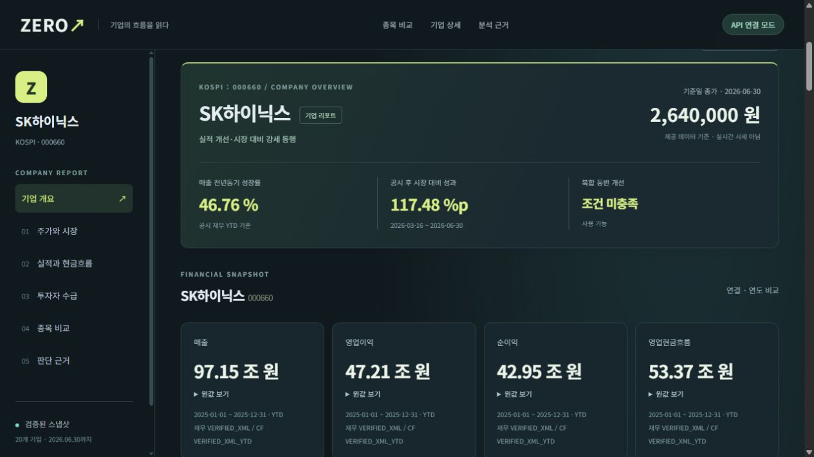
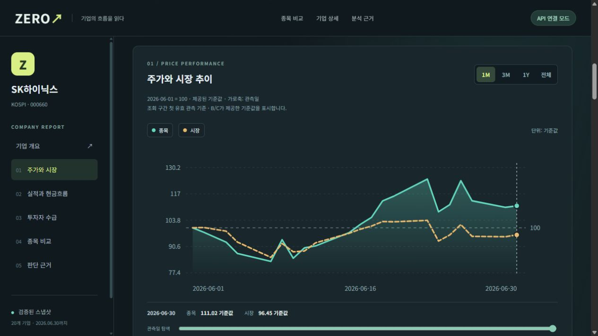
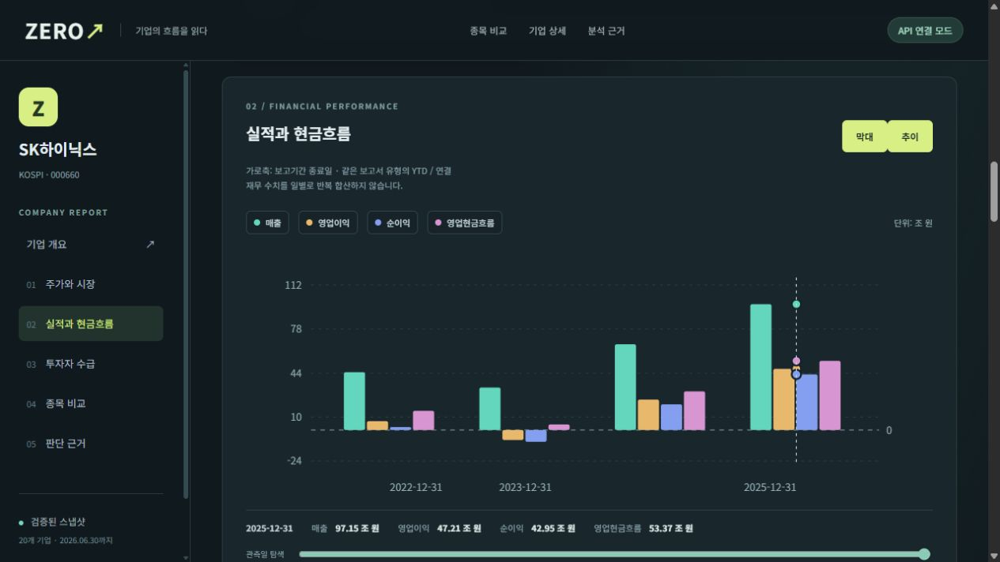
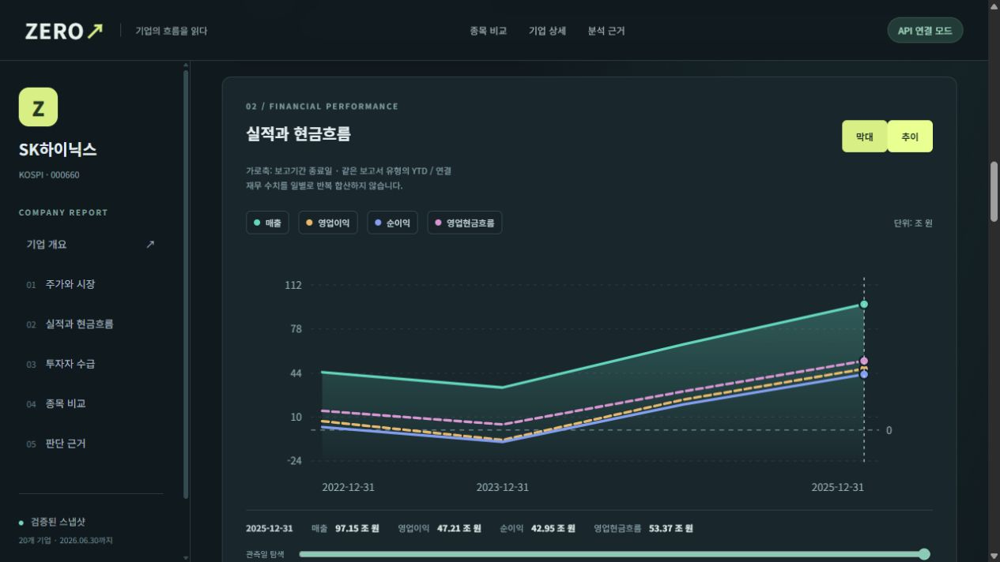
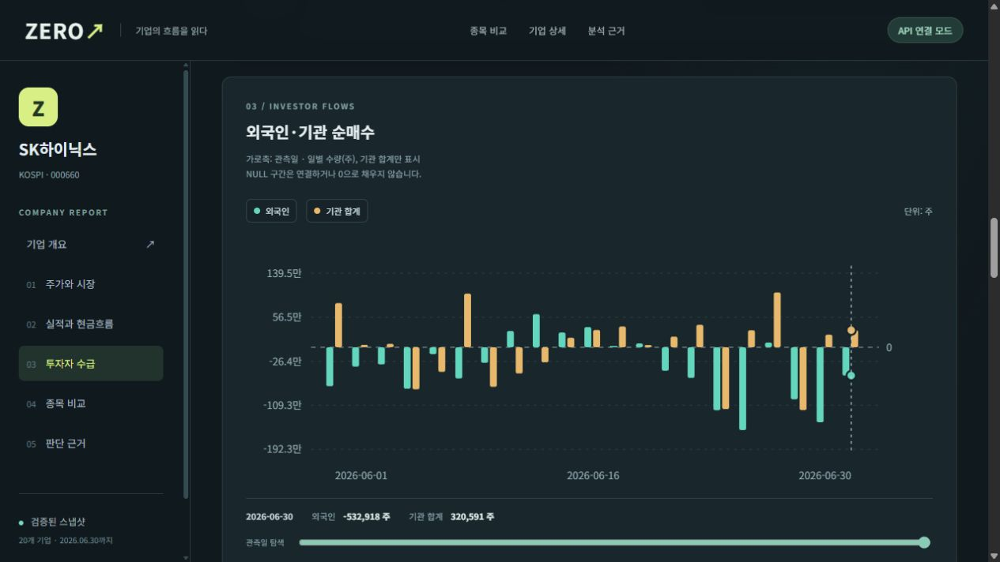
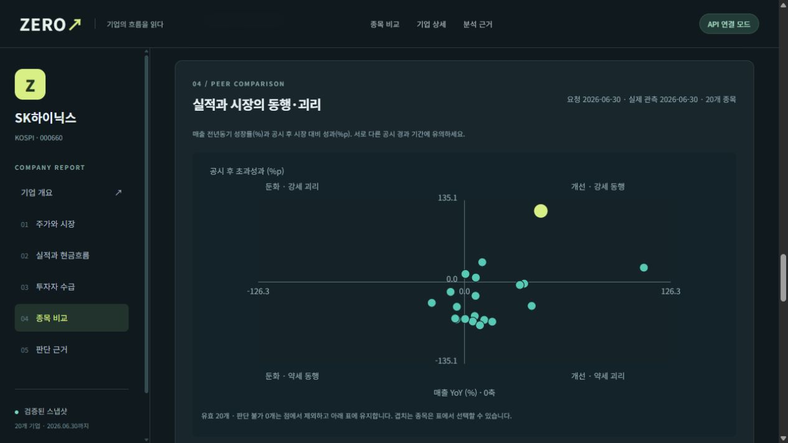
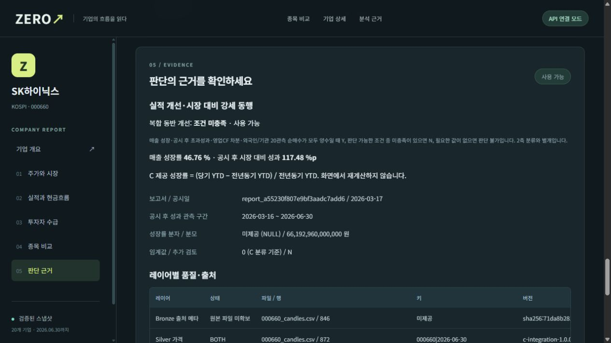

# 대시보드 화면 갤러리

[저장소 안내로 돌아가기](../README.md)

촬영일: 2026-10-15 · 구현 기준: `8a9fce00d8181a95a960c543dbd0da88e23e41be` (PR #12 병합).
SK하이닉스(000660), 연결·사업보고서, 주가 조회 2026-06-01~2026-06-30. B API 1.1과 C 실제 분석 산출물을 연결한 로컬 화면입니다. 계정 정보와 인증 화면은 포함하지 않습니다.

## 자동 화면 투어

7장의 실제 캡처를 3.5초씩 보여주는 약 25초 반복 GIF입니다. 연속 영상 녹화가 아닌 장면별 화면 투어이며, 아래 원본 이미지로 글자와 그래프를 확대해 볼 수 있습니다.

## 기업 개요와 핵심 재무

기업 요약, 기준일 종가, 성장률과 조·억 단위 금액. 정확한 금액은 원값 보기에서 확인합니다.

## 주가와 시장

종목과 시장의 기준값 비교, 기간 선택, 관측일 탐색.

## 실적과 현금흐름 — 막대

같은 보고서 유형의 매출·영업이익·순이익·영업현금흐름을 비교합니다.

## 실적과 현금흐름 — 추이

같은 데이터를 추이형으로 전환한 화면입니다.

## 투자자 수급

외국인·기관의 일별 순매수 수량을 양수·음수 막대로 표시합니다.

## 종목 비교

실적 성장과 시장 대비 성과의 동행·괴리를 20종목 범위에서 비교합니다.

## 판단 근거와 출처

계산 기준, 관측 구간, 레이어별 출처와 검토 상태를 확인합니다.

## 범위

기준 데이터는 2026-06-30까지의 20종목입니다. 실시간 시세·투자 추천이 아닙니다. 화면 통합 완료와 원본/DB 전체 증빙 완료는 별개이며 [현재 검증 결과](handoffs/A-visual-merge.md)를 참고하세요.
